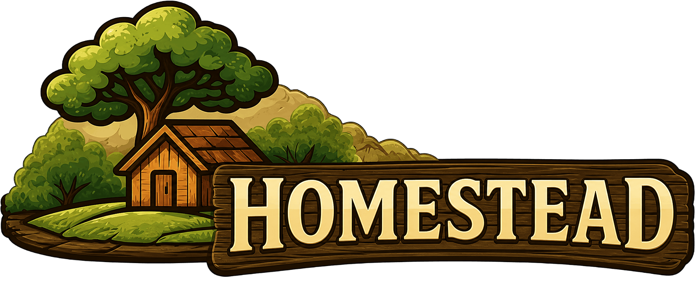

# Homestead Systems

We run community game servers, build tools for Discord, and host services for developers and communities.

[**Join the Discord**](https://discord.gg/qM9Tk2xQ79) · [Visit Homestead Systems](https://homestead.systems)

## Game servers

Play Minecraft, Valheim, Stardew Valley, and more with the Homestead community. Join the [Discord](https://discord.gg/qM9Tk2xQ79) to find out what’s running and how to connect.

## M.U.L.E.

**Modular Utility Logistical Engine** is a Discord bot built around modules, so communities can choose the tools they need.

[Explore M.U.L.E. →](https://homestead.systems/mule)

## Hosted services

| Service | What it’s for |
| --- | --- |
| [GitLab](https://git.homestead.systems) | Repository hosting, GitLab Pages, and CI runners for Alpine Linux and Windows. Public repositories are viewable without an account; registration requires approval. |
| [SearXNG](https://sear.homestead.systems) | A self-hosted metasearch engine. |
| [Coding activity](https://waka.homestead.systems) | Self-hosted coding activity tracking for WakaTime clients. |
| [ShareX uploader](https://share.homestead.systems) | Homestead Discord members can register to upload images, videos, and files from ShareX and get links to share in Discord. |
| Matrix · [Cinny](https://cinny.homestead.systems) / [Element](https://element.homestead.systems) | Two web clients for the Homestead Matrix server. |

## In development

**Crack The Geode** is a Roblox game in development. Chip away at a giant generated geode one tiny square at a time, then upgrade your gear to break off bigger pieces.
